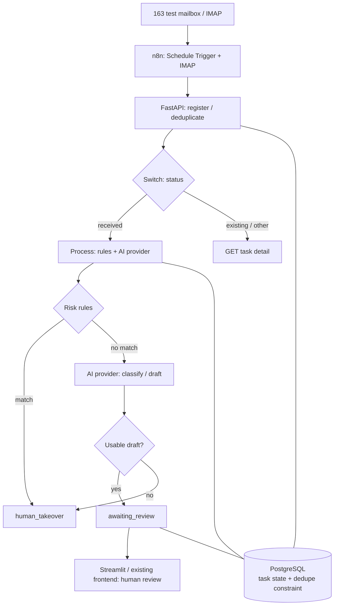

[English](README.md) | [简体中文](README.zh-CN.md)

# AI-Assisted Email Triage & Human Review

**A human-in-the-loop workflow that turns a crowded sales or support inbox into organized, reviewed reply drafts — without letting AI talk to customers on its own.**

The system ingests email through n8n, registers and deduplicates it in FastAPI, applies deterministic risk rules before any model call, generates an AI-assisted classification and draft, and stops every customer-facing result at a human review gate.

> **Status: portfolio / reference implementation, not production software.**
> As of **2026-11-19**, the main stack uses n8n on `5679`, FastAPI on `8014`, PostgreSQL on `5432`, and Streamlit on `8504` (started when needed). The offline demo uses `8020` / `8503`.
>
> The main stack's email `process` currently uses `AI_PROVIDER=deepseek` from `.env`; the demo is fixed to `mock`. The standalone `/api/v1/ai/triage` endpoint is a keyword-based Mock in both stacks and does not read `AI_PROVIDER`.
>
> **No email is sent.** `approved` means a human approved the draft, not that a message was delivered. The historical 7-email / 257-test results below are not from the current verification run.

## The problem

A support or sales inbox is not one kind of work. It mixes product questions, pricing requests, order changes, refunds, complaints, and occasional legal threats — all in one queue, all expecting a fast answer.

Reading and sorting every message manually is slow and error-prone. Letting a language model reply automatically is faster, but it is the wrong trade for refunds, complaints, and legal language. The expensive mistakes are not typos; they are commitments made without context.

This project takes the middle path:

1. **Automate the repetitive work** — retrieval, normalization, deduplication, classification, summarization, and draft generation.
2. **Never automate the judgment** — every draft stops at a human review gate.
3. **Let risky messages skip the model** — deterministic rules send refunds, complaints, legal language, order changes, and account/payment changes straight to human takeover.

## Core capabilities

- **Database-level deduplication.** `mailbox_id + message_id` is a unique key. A first submission returns `201` + `received`; a duplicate returns `200` + `duplicate=true` and reuses the existing task.
- **Rules before AI.** Legal/complaint/compensation, refund/chargeback, order changes, and payment/account changes are checked first. A match goes to `human_takeover` without calling the AI provider.
- **Pluggable provider layer.** The demo uses a deterministic offline `MockAIProvider`; the main stack can use the optional `DeepSeekAIProvider`. The standalone triage endpoint remains Mock.
- **Human review state machine.** `approve`, `reject`, and `takeover` are accepted only for `awaiting_review`. `approve` requires a non-empty draft; reviewers can save an edited `draft_body`.
- **Two review interfaces.** A minimal same-origin page at `/ui` and a bilingual Streamlit inbox (`frontend_app.py`) with an English / 中文 switch, pending list, detail view, editable draft, and review buttons.
- **A reproducible offline demo.** PostgreSQL, FastAPI, and Streamlit run in an isolated Compose project with no mailbox, no n8n, and no external AI credentials.

## Current topology

| Role | Main stack: real chain | Demo stack: offline subset |
| --- | --- | --- |
| Orchestration | n8n `5679` (`ai-support-n8n-manual-stage6`) | No n8n |
| API | FastAPI `8014` | FastAPI `8020` |
| Database | PostgreSQL `5432`, `ai_support` | Internal PostgreSQL, `ai_support_demo` |
| Review UI | Streamlit `8504` (start when needed) | Streamlit `8503` |
| Email input | 163 test mailbox via IMAP | Synthetic email via API |
| AI provider | Email `process` reads `.env` (currently `deepseek`) | Fixed `mock` |
| Best for | Real end-to-end validation / recording | Fast local review-flow evaluation / CI |

The two stacks share the same application code and database model, but they use separate databases, ports, and provider settings. n8n must target the main API on `8014`, not the demo API on `8020`.

## Architecture



The diagram shows the **main stack**. The demo stack omits n8n and injects synthetic messages directly through `POST /api/v1/emails`, then reuses the same FastAPI + PostgreSQL + Streamlit review flow.

The current n8n workflow (`stage6-empty-workflow`, active) is:

```text
Schedule Trigger (1 min)
  → GetEmailsList email (IMAP)
  → Code in JavaScript
  → Register Email (http://172.17.0.1:8014/api/v1/emails)
  → Switch
      → Process Email (http://172.17.0.1:8014/api/v1/emails/{id}/process)
      → Get Existing Task (http://172.17.0.1:8014/api/v1/emails/{id})
```

> The AI node was removed from the email chain. It previously sat between Register and Switch, overwrote the task `status` with `intent/urgency/...`, and forced Switch into the "existing task" branch. AI classification now happens inside `process`. The standalone `/api/v1/ai/triage` endpoint is not part of the email chain.

## Human-in-the-loop by design

```text
received → processing → awaiting_review → approved / rejected / human_takeover
                     ↘ human_takeover / failed
```

- **Rules first.** Legal/complaint/compensation > refund/chargeback > order change > payment/account change. A rule hit goes to `human_takeover`; the provider is not called.
- **AI second.** Only messages that pass the rule gate reach the provider. A non-high-risk result with a non-empty draft becomes `awaiting_review`; high-risk categories or an unusable draft go to `human_takeover`.
- **Human last — and always.** The reviewer can approve, reject, or take over. `approve` requires a non-empty draft; an edited draft can be saved with the decision.
- **Approval is not delivery.** There is no `sent` or `sending` state and no SMTP/API sending path. `approved` is strictly a human review outcome.
- **Reviewer identity is demo-only.** `reviewed_by` is a client-supplied string, not an authenticated identity. Production authentication is not implemented.

## Current verification status

### Verified in the current environment (2026-11-19)

- **14 non-database tests passed, 1 warning** (AI triage, health, and UI tests).
- Health checks passed for the main API `8014`, demo API `8020`, and n8n `5679`.
- The n8n workflow `stage6-empty-workflow` is **active** (`n8n list:workflow --active=true`).
- The email chain was corrected to `Register Email → Switch → Process/Get`.
- A synthetic email processed through a temporary 18014 instance reached `awaiting_review`.
- `POST /api/v1/ai/triage` returns `exchange` for the test payload `{"subject":"换货","body":"尺码小了"}`.

### Historical records (not re-run in this pass)

- Historically, 7 test emails were read from the real 163 mailbox; the real IMAP workflow lives in n8n UI / the 5679 data volume and is **not exported in this repository**.
- An isolated full test run previously recorded **257 passed, 1 warning, 0 failed, 0 skipped**.
- DeepSeek was exercised on a limited number of synthetic emails only.

### Known issues

- One existing test task returned **500** from `/process` and remains in `processing`. The system has **no automatic retry or processing timeout recovery**.
- The main database already contains historical test tasks, including `processing` records. Use fresh test data or a clean test database before a demo.
- The main stack's email `process` currently uses DeepSeek; the demo is Mock. Do not describe both as Mock.
- No production-grade authentication, no real email sending, no pagination, no multi-tenancy, no sender field, and no draft history.
- No production stability claim. DeepSeek sends email content to a third party when enabled; use synthetic or redacted data only.
- The historical 7-email and 257-test results must not be presented as current results.

## Quick start: main stack

```bash
cd /home/leo/Documents/ai-support-workflow

# 1) Main database; n8n 5679 is an existing manual container
docker compose up -d db

# 2) Main FastAPI; bind 0.0.0.0 so the n8n container can reach it
source .venv/bin/activate
alembic upgrade head
uvicorn app.main:app --host 0.0.0.0 --port 8014 --reload

# 3) Main Streamlit (separate terminal)
source .venv/bin/activate
API_BASE_URL=http://127.0.0.1:8014 \
  streamlit run frontend_app.py --server.port 8504
```

| Service | Address |
| --- | --- |
| n8n UI | http://127.0.0.1:5679 |
| Main FastAPI | http://127.0.0.1:8014 |
| Main Streamlit | http://127.0.0.1:8504 |
| PostgreSQL | localhost:5432, database `ai_support` |

`5678` is retired. The n8n service in the root `docker-compose.yml` is available only through `--profile legacy`; do not start it by default.

Check that the n8n container can reach the main API:

```bash
docker exec ai-support-n8n-manual-stage6 \
  wget -qO- http://172.17.0.1:8014/health
```

For a new email, send it to the dedicated 163 test mailbox; the active one-minute schedule picks it up, or run the workflow manually in n8n.

## Quick start: offline demo

```bash
docker compose -p ai-support-demo -f docker-compose.demo.yml build
docker compose -p ai-support-demo -f docker-compose.demo.yml up -d --no-build
docker compose -p ai-support-demo -f docker-compose.demo.yml ps
```

| Service | Address |
| --- | --- |
| Demo FastAPI | http://127.0.0.1:8020 |
| API docs | http://127.0.0.1:8020/docs |
| Demo Streamlit | http://127.0.0.1:8503 |
| Demo PostgreSQL | Internal Compose network only |

Create a synthetic email and run it through `process`:

```bash
CREATE_RESPONSE=$(curl -sS -X POST http://127.0.0.1:8020/api/v1/emails \
  -H 'Content-Type: application/json' \
  -d '{"mailbox_id":"demo@example.com","message_id":"<demo-en-001@example.com>","subject":"Product feature question","body":"Does this servo motor support 48V?"}')

TASK_ID=$(printf '%s' "$CREATE_RESPONSE" | python3 -c 'import json,sys; print(json.load(sys.stdin)["id"])')
echo "task_id=$TASK_ID"

curl -sS -X POST "http://127.0.0.1:8020/api/v1/emails/$TASK_ID/process"
```

The product question should return `status: "awaiting_review"`. Open `http://127.0.0.1:8503` to view the review task. The demo has no mailbox, no n8n, and is fixed to `AI_PROVIDER=mock`.

## Standalone AI triage endpoint

Both the main API `8014` and demo API `8020` expose the same Mock endpoint:

```bash
curl -X POST http://127.0.0.1:8014/api/v1/ai/triage \
  -H 'Content-Type: application/json' \
  -d '{"subject":"Exchange request","body":"The size is too small"}'
```

Response:

```json
{
  "intent": "exchange",
  "urgency": "medium",
  "confidence": 0.9,
  "summary": "客户提出换货请求，建议人工确认尺码和库存。"
}
```

This endpoint is keyword-based Mock logic. It does not call DeepSeek/OpenAI, does not read `AI_PROVIDER`, and is not part of the n8n email chain. The current Mock summaries are Chinese; the response schema is language-neutral.

## API surface

| Method and path | Purpose |
| --- | --- |
| `POST /api/v1/emails` | Register an email; deduplicates by `mailbox_id + message_id` |
| `GET /api/v1/emails` | List tasks for the review inbox |
| `GET /api/v1/emails/{id}` | Read task detail: original content, classification, risk, draft, review fields |
| `POST /api/v1/emails/{id}/process` | Run rules + the configured AI provider |
| `POST /api/v1/emails/{id}/review` | `approve` / `reject` / `takeover`, optionally with an edited `draft_body` |
| `POST /api/v1/ai/triage` | Standalone keyword Mock triage endpoint |
| `GET /health` | Process health check |
| `GET /docs` | Interactive OpenAPI documentation |

Example review request:

```json
{
  "action": "approve",
  "reviewed_by": "reviewer@your-company.example",
  "review_comment": "Checked wording; no price or delivery commitment.",
  "draft_body": "Hi Alex, thanks for reaching out. ..."
}
```

Integration notes:

- **CORS is not configured.** Serve the API and frontend behind the same reverse proxy, or add CORS in your own deployment.
- **Add authentication before exposure.** The repository has no auth layer; put it behind your SSO/API gateway.
- **Add pagination and tenant scoping** before using a real, growing inbox or multiple customers.
- **Keep the human gate.** If you add sending later, make it a separate authorized step; `approved` currently does not send anything.
- **The API is UI-agnostic.** Streamlit and `/ui` are reference clients; an existing React/Vue/server-rendered frontend can replace them.
- To replace n8n, implement an adapter that calls `POST /api/v1/emails` and `POST /api/v1/emails/{id}/process`; this API stores no IMAP credentials and does no mailbox polling.

## Project structure

```text
app/
  api/routes/emails.py       registration, list, detail, process, review
  api/routes/ai.py           standalone Mock /ai/triage route
  services/rules.py          deterministic risk rules
  services/triage.py         rule gate, provider orchestration, state transitions
  services/review.py         approve / reject / takeover
  providers/ai/              Mock and optional DeepSeek providers
  core/email_status.py       status values and allowed transitions
  db/models.py               EmailTask + unique dedupe constraint
  static/review.html         minimal same-origin /ui review page
frontend_app.py              bilingual Streamlit review inbox
alembic/                     database migrations
docker-compose.yml           main PostgreSQL; n8n is a legacy profile
docker-compose.demo.yml      isolated PostgreSQL + FastAPI + Streamlit demo
Dockerfile.api / Dockerfile.ui
n8n/workflows/               early Webhook draft only (not the real IMAP export)
tests/                       API, service, provider, UI, and concurrency tests
```

## Current limitations

- **No production-grade authentication or authorization.** `reviewed_by` is a client-supplied demo value.
- **No real email sending.** There is no SMTP client, send API, or `sent`/`sending` state.
- **No pagination and no multi-tenancy.** The list endpoint returns all tasks; the schema has no tenant field.
- **No production stability claim.** There is no automatic retry, processing timeout recovery, or exactly-once guarantee.
- **DeepSeek is only lightly validated.** It was exercised on a limited number of synthetic emails; quality, latency, cost, and failure behavior at scale are not characterized.
- **The real IMAP workflow is not in this repository.** It lives in n8n UI / the 5679 data volume; there is no verified IMAP export here. `n8n/workflows/` contains an early Webhook draft only.
- **Risk rules are keyword-based.** They can miss synonyms, misspellings, and other languages, or match the wrong context.
- No sender field, attachments, threads, or draft history; CORS is not configured; dependencies are range-pinned, not locked.

## Security notes

- Do not commit `.env`, IMAP authorization codes, or API keys.
- Use only a dedicated test mailbox and synthetic/redacted content for public demos.
- The API returns full email bodies and drafts and has no production authentication; do not expose it to the public internet as-is.
- Enabling DeepSeek sends email content to a third party. Use synthetic or redacted data only.
- Risk rules are a triage aid, not a security control.

## Documentation

The primary English overview is this file. Detailed operational documents are currently in Chinese:

- [简体中文 README](README.zh-CN.md)
- [Ports and responsibilities](docs/PORTS.md) — authoritative port map
- [Usage guide](docs/USAGE.md) — main stack, demo, n8n, AI triage, troubleshooting
- [AI handoff context](docs/AI_CONTEXT.md) — current facts, known issues, and constraints
- [90-second recording guide](RECORDING_GUIDE.md)
- [Roadmap](docs/PROJECT_ROADMAP.md)
- [Early n8n Webhook draft notes](docs/n8n-integration.md)

---

**Project status:** portfolio / reference implementation. The workflow demonstrates AI-assisted triage with a mandatory human review gate; it is not a production email system. `approved` does not mean sent.