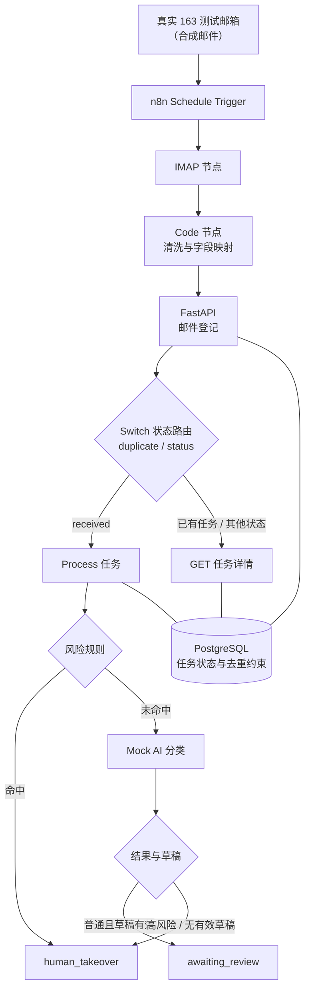

# AI 邮件分流与人工审核系统

> 真实 IMAP 邮件进入 n8n 后，由 FastAPI 完成登记、去重、风险规则检查、AI 辅助分流和人工审核状态管理。
>
> **项目定位**：可演示的 Portfolio Demo。当前 AI 分类使用离线 Mock Provider，尚未接入真实大模型，也尚未实现前端审核界面和邮件发送。

`FastAPI` · `PostgreSQL` · `SQLAlchemy` · `Alembic` · `n8n` · `Mock AI`

> **文档口径**：本文区分已确认事实、当前未实现功能和后续规划。事实部分来自项目阶段报告及用户提供的真实联调记录。本次 README 更新没有重新运行测试、没有执行数据库迁移，也没有重新连接真实邮箱或 `ai_support` 数据库。

## 项目价值

- 自动接收并登记邮件，减少人工搬运邮件信息。
- 以 `mailbox_id + message_id` 去重，避免同一来源邮件重复创建任务。
- 高风险内容优先转人工，避免自动生成不当回复。
- 普通内容在生成有效草稿后进入待审核状态，人工确认后才进入下一阶段。
- 用明确的任务状态为后续审核、发送和可靠性处理提供基础。

当前系统不包含自动发送、生产级鉴权或完整商业产品能力。

## 当前架构



当前真实链路的节点顺序：

```text
真实 163 测试邮箱
  → n8n Schedule Trigger
  → IMAP 节点
  → Code 节点（清洗与字段映射）
  → FastAPI POST /api/v1/emails
  → Switch 状态路由（duplicate / status）
  → Process 任务或 GET 已有任务详情
  → awaiting_review / human_takeover
```

- n8n 负责定时触发、IMAP 读取和流程编排。
- FastAPI 负责邮件登记、去重、风险规则、状态机与数据库写入。
- PostgreSQL 负责任务状态持久化和 `mailbox_id + message_id` 唯一约束。
- Mock AI 当前仅用于离线、确定性的分类和草稿生成，不访问网络。
- 上述真实链路是 n8n UI 中实际配置的工作流，不是仓库内早期测试 Webhook JSON。

### 技术栈现状

| 组件 | 作用 | 当前状态 |
| --- | --- | --- |
| FastAPI | HTTP API 与业务流程入口 | 已实现 |
| PostgreSQL | 任务状态与去重约束 | 已接入 |
| SQLAlchemy 2.x + Alembic | ORM 与数据库迁移 | 已实现 |
| n8n | 定时触发、IMAP 读取、流程编排 | 已接入真实 163 测试邮箱 |
| Mock AI Provider | 离线、确定性的分类与草稿 | 当前唯一 AI Provider |
| Streamlit | 人工审核前端 | 尚未实现 |

## 核心流程

### 邮件登记

`POST /api/v1/emails` 接收 `mailbox_id`、`message_id`、`subject`、`body` 四个字段。其中 `mailbox_id` 与 `message_id` 必填，`subject`、`body` 可缺省为空字符串。首次登记创建任务，状态为 `received`；该接口不会调用 AI，也不会发送邮件。

### 去重

`mailbox_id + message_id` 在数据库层有唯一约束。重复登记返回已有任务和 `duplicate=true`，不会新增记录；并发插入由数据库唯一约束兜底，冲突时回滚并复用已提交记录。

### Process 与状态流转

`POST /api/v1/emails/{task_id}/process` 只处理 `received` 状态的任务：先原子认领为 `processing`，再执行风险规则；规则未命中时才调用 Mock AI，最后把结果写回数据库。

- 风险规则命中：直接进入 `human_takeover`，不调用 Mock AI。
- 普通分类且存在非空草稿：进入 `awaiting_review`。
- 高风险分类或没有可审核草稿：进入 `human_takeover`。
- Provider 调用或输出校验失败：任务标记为 `failed`。
- 对 `awaiting_review` 的重复 process 返回已有结果（200）；`processing` 或终态返回 409。

### 已有任务与重复邮件

工作流根据登记响应中的 `duplicate` 和 `status` 路由。已有任务通过 `GET /api/v1/emails/{task_id}` 查询详情，不重复创建任务，也不重复执行 process。真实联调中，历史邮件走的就是该分支。

### 风险规则

规则服务基于主题和正文中的关键词判断，优先级为：法律/投诉/赔偿 > 退款/拒付 > 订单修改 > 付款/账户权限修改。正文为空或仅空白也会直接要求人工处理。

规则命中即进入 `human_takeover`，不调用 Mock AI。规则未命中不代表邮件安全，生成的草稿仍然必须人工审核。精确关键词规则可能漏判同义词、拼写错误或其他语言，也可能误判。

### 人工审核

`POST /api/v1/emails/{task_id}/review` 支持 `approve`、`reject`、`takeover` 三种动作，只接受 `awaiting_review` 状态的任务。

- `approve` 要求草稿存在且去除空白后非空。
- `reject` 和 `takeover` 允许处理异常记录。
- `reviewed_by` 是客户端自报的演示值，不代表真实身份。
- 当前没有前端审核页面，审核动作需要通过 API 调用。

### 状态语义

```text
received → processing → awaiting_review → approved / rejected / human_takeover
                     ↘ human_takeover / failed
```

终态为 `approved`、`rejected`、`human_takeover`、`failed`。

**`approved` 仅表示人工审核通过，不表示邮件已发送。** 系统当前没有 `sent` / `sending` 状态，也没有真实发送能力。

## 真实 IMAP 接入

当前使用专用 163 测试邮箱和合成邮件进行演示，不接入真实客户邮箱。

- 工作流在 n8n UI 中配置，由 Schedule Trigger 定时触发读取。
- 读取节点是 n8n 社区 IMAP 节点，不是原先的测试 Webhook。
- IMAP 节点读取邮件后，由 Code 节点清洗并映射为 FastAPI 需要的四个字段：`mailbox_id`、`message_id`、`subject`、`body`。
- 历史邮件在登记时返回 `duplicate=true`，工作流进入已有任务查询分支，不重复处理。
- 联调中 163 邮箱曾返回 `SELECT Unsafe Login`。最终通过兼容的 IMAP 节点与配置完成了真实邮件拉取；这是客户端兼容性处理，不是对网易安全机制的绕过，本文不推测其底层实现细节。
- IMAP 授权码不保存在仓库、README 或工作流 JSON 中；请只在实际 n8n 实例的安全凭据配置中使用，不要写入文档或提交历史。
- 仓库中的 `n8n/workflows/06_test_webhook_triage.json` 是早期测试 Webhook 草稿，不是当前真实 IMAP 工作流。当前真实工作流在 n8n UI 中配置，仓库未包含经过验证的 IMAP 工作流导出文件。

本次联调中，n8n 曾成功读取 7 封测试邮件，其中包括历史邮件和新邮件。这些结果说明当前真实邮箱到 FastAPI 的演示链路已经跑通，但不代表压力测试、长期稳定性或生产可靠性。本文不固定该社区节点的包名、版本或底层库实现，具体以当前 n8n 实例为准。

## API 摘要

| 方法与路径 | 用途 | 关键行为 |
| --- | --- | --- |
| `POST /api/v1/emails` | 登记邮件 | 首次创建返回 `201`，状态 `received`；重复登记返回 `200`、`duplicate=true` 和已有任务 |
| `GET /api/v1/emails/{task_id}` | 查询任务详情 | 只读，返回正文、分类、风险、草稿和审核字段；任务不存在返回 `404` |
| `POST /api/v1/emails/{task_id}/process` | 执行规则与 Mock AI 分流 | 仅处理 `received`；结果为 `awaiting_review` 或 `human_takeover`；Provider 失败标记 `failed` |
| `POST /api/v1/emails/{task_id}/review` | 人工审核 | 支持 `approve` / `reject` / `takeover`；仅接受 `awaiting_review`；`approve` 要求非空草稿 |

补充说明：

- `process` 对 `processing` 或终态任务返回 409；Provider 失败返回 502 且任务为 `failed`；数据库异常返回 503，任务状态可能不确定。
- `review` 在 `approve` 没有可用草稿时返回 409。
- 所有接口当前都没有生产级鉴权。

重要状态：

| 状态 | 含义 |
| --- | --- |
| `received` | 已登记，等待处理 |
| `processing` | 正在处理 |
| `awaiting_review` | 已生成可审核草稿，等待人工审核 |
| `approved` | 审核通过；不代表已发送 |
| `rejected` | 审核拒绝 |
| `human_takeover` | 需要人工接管 |
| `failed` | 处理失败 |

当前**没有任务列表接口**，也**没有 Streamlit 页面或 Streamlit 专用接口**；尚未提供发件人字段和草稿修改保存接口。

`GET /health` 只返回进程状态，不检查数据库连通性。FastAPI 启动后可通过 `/docs` 查看 OpenAPI 文档。

## 验证结果

| 场景 | 观察结果 |
| --- | --- |
| 普通新邮件 | 进入 Process 分支，最终为 `awaiting_review` |
| 退款新邮件 | 命中退款规则，进入 `human_takeover`，不调用 Mock AI |
| 历史/重复邮件 | 登记返回 `duplicate=true`，进入已有任务查询分支 |
| 真实邮箱读取 | n8n 成功读取 7 封测试邮件，包含历史邮件和新邮件 |

> **说明**：以上为当前真实联调演示结果，不等同于压力测试或生产稳定性证明。

根据阶段测试报告，自动化测试记录为 172 passed。本次 README 更新不重新运行测试。GitHub Actions 和当前工作区是否重新验证，不在本次文档更新范围内。

## 当前状态

已完成：

- [x] FastAPI + PostgreSQL 后端
- [x] 邮件登记与 `mailbox_id + message_id` 去重
- [x] 风险规则
- [x] Mock AI 分类与草稿
- [x] process API 与任务详情查询
- [x] 人工审核状态机（approve / reject / takeover）
- [x] n8n 真实 163 IMAP 接入
- [x] 真实邮箱到 FastAPI 的分流联调（7 封测试邮件演示）
- [x] Alembic 迁移，以及阶段报告记录的 PostgreSQL 并发相关测试

关键实现位于 `app/api/routes/emails.py`、`app/services/triage.py`、`app/services/rules.py`、`app/services/review.py` 和 `app/providers/ai/mock_provider.py`。

## 后续规划

以下均为规划，尚未实现。

### V2：真实 AI Provider

- 接入 DeepSeek。
- 保留 Mock Provider 用于离线回归。
- 增加超时、错误映射和结构化输出校验。
- 不把真实 API Key 写入仓库。

### V3：人工审核前端

- 使用 Streamlit 或其他前端。
- 提供待审核列表。
- 展示邮件详情、摘要、风险和草稿。
- 支持审核动作。
- 需要先补齐列表 API、发件人字段和草稿修改保存契约。

### V4：发送与可靠性

- 实现人工批准后的发送。
- 定义发送状态和幂等边界。
- 增加 Error Trigger。
- 实现受控重试和告警。
- 不把 `approved` 直接描述为 `sent`。

## 当前限制

- 当前 AI Provider 仍为 Mock；尚未接入 DeepSeek。
- 尚未实现前端审核 UI。
- 尚未实现真实邮件发送。
- 当前不连接 Slack。
- 无生产级鉴权。
- 无自动重试。
- `processing` 超时回收尚未实现。
- 不承诺 exactly-once。
- 风险规则基于关键词，可能误判或漏判。
- 尚无任务列表 API、发件人字段和草稿修改保存契约。
- 真实邮箱验证使用专用测试邮箱和合成邮件，结果不等于生产稳定性证明。

## 安全说明

- 不要提交 IMAP 授权码、DeepSeek API Key 或 `.env`。
- 真实邮箱只使用专用测试账号，不要接入真实客户邮箱做公开演示。
- 邮件正文和 AI 草稿属于敏感数据；当前 `GET` 详情会返回正文和草稿，且没有生产级鉴权。
- 当前 API 尚无生产级鉴权；前端尚未实现。
- 本项目当前定位为可演示的 Portfolio Demo，不应直接用于生产环境。

## 运行与配置

当前仓库包含 FastAPI 应用、Alembic 迁移、PostgreSQL + n8n 的 Docker Compose 配置，以及 n8n 早期测试工作流草稿。真实链路还依赖 n8n UI 中的 IMAP 凭据和 FastAPI 访问地址配置；本次 README 更新没有重新验证完整启动流程，因此不提供未经本轮验证的命令序列。

| 配置项 | 作用 | 当前说明 |
| --- | --- | --- |
| `DATABASE_URL` | FastAPI 与 Alembic 的 PostgreSQL 连接 | 使用 psycopg 3 DSN；`.env.example` 只包含本地演示默认值 |
| n8n IMAP 凭据 | 读取 163 测试邮箱 | 在 n8n 实例的凭据配置中设置，不进入仓库 |
| n8n 中的 FastAPI Base URL | 让 n8n 调用登记、process 和 GET 接口 | 应配置在 n8n 工作流或环境变量中，不要从 Webhook 输入接收 |
| AI Provider | 分类与草稿生成 | 当前默认使用 Mock；代码通过依赖注入返回 `MockAIProvider`，尚未提供真实 Provider 的切换配置或密钥项 |

其他说明：

- Python 要求为 3.10 及以上；PostgreSQL 使用 Docker Compose 中的 16 版本。
- Docker Compose 当前包含 PostgreSQL 与 n8n，不包含 FastAPI 服务；FastAPI 需单独运行。
- n8n 版本未在仓库中固定，具体节点行为以当前 n8n 实例为准。
- `.env` 已被 `.gitignore` 忽略；不要提交任何真实凭据。
- 当前代码没有 `AI_PROVIDER` 环境变量；`get_ai_provider()` 固定返回 `MockAIProvider`，尚未实现真实 Provider 的切换逻辑。
- FastAPI 的 `/health` 仅用于确认进程可访问，不验证数据库；接口文档可在 `/docs` 查看。
