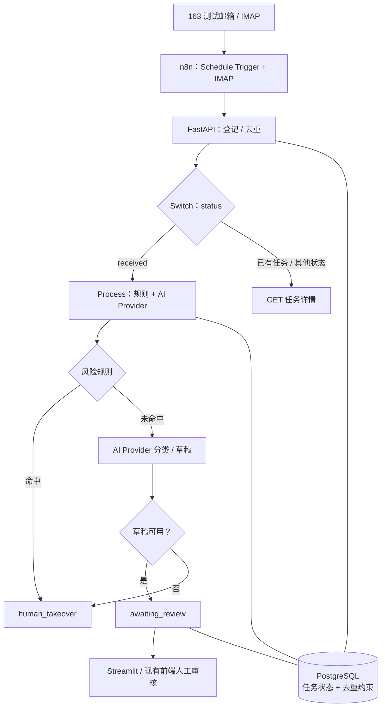

[English](README.md) | [简体中文](README.zh-CN.md)

# AI 邮件分诊与人工审核系统

> **当前事实（2026-11-19）**：主栈是 n8n 5679 + FastAPI 8014 + PostgreSQL 5432 + Streamlit 8504；Demo 栈是 FastAPI 8020 + Streamlit 8503。
> 端口权威表：[docs/PORTS.md](docs/PORTS.md)；使用步骤：[docs/USAGE.md](docs/USAGE.md)；给其他 AI 的交接说明：[docs/AI_CONTEXT.md](docs/AI_CONTEXT.md)。
>
> 图中的 7 封 IMAP、257 passed 是历史记录，**不是本次重跑结果**。当前 workflow 已激活，但已有测试任务出现过 `/process` 500 并停留在 `processing`。

## 这套系统解决什么问题

销售/客服每天收到大量产品咨询、报价、订单修改、退款、投诉甚至法律相关邮件。逐封阅读和分类很慢；让 AI 直接回复又太危险。

这个项目采用中间路线：

1. 自动接收、清洗、登记和去重邮件；
2. 用确定性规则先拦截高风险邮件；
3. 规则未命中时才交给 AI 分类、摘要、生成草稿；
4. 所有草稿必须经过人工审核。

AI 只写草稿，人工做决定。系统没有自动发送邮件的能力。

## 两套运行方式

| | 主栈：真实链路 | Demo 栈：离线子集 |
| --- | --- | --- |
| 组成 | `ai-support-db` + `ai-support-n8n-manual-stage6` + 本地 FastAPI + Streamlit | `ai-support-demo-db` + `ai-support-demo-api` + `ai-support-demo-ui` |
| 端口 | 5432 / 5679 / 8014 / 8504 | 8020 / 8503（DB 仅内部网络） |
| 邮件入口 | n8n 通过 IMAP 读取 163 测试邮箱 | API 写入合成邮件 |
| AI Provider | 邮件 `process` 按 `.env`，当前 `deepseek` | 固定 `mock` |
| 适合 | 真实链路、录屏、端到端验证 | 无需邮箱快速体验、审核流程演示 |

两套栈共用业务代码，但不要混用端口和目标地址。n8n 只应指向主 API 8014，不应指向 Demo 8020。

## 架构



> 架构图是主栈链路。Demo 栈省略 n8n，直接从 `POST /api/v1/emails` 注入合成邮件，后续复用同一套 FastAPI + PostgreSQL + Streamlit。
>
> 当前 n8n workflow 里 **AI 节点已从邮件主链路移除**；邮件分类由 `process` 完成。`/api/v1/ai/triage` 是独立 Mock 接口，不属于这条链路。

## 当前状态：真实进度

### 本机已验证

- 不依赖数据库的测试：**14 passed, 1 warning**（AI 分诊、health、UI）。
- 主 API 8014、Demo API 8020、n8n 5679 健康检查通过。
- 5679 的 `stage6-empty-workflow` 已激活：`n8n list:workflow --active=true` 能看到。
- n8n 邮件链路已修正为 `Register Email → Switch → Process/Get`，不再被 AI 节点截断。
- 合成邮件在临时 18014 实例上 `process` 成功，返回 `awaiting_review`。
- `/api/v1/ai/triage` 对“换货 / 尺码小了”返回 `exchange`。

### 历史记录（本次未重跑）

- 真实 163 IMAP 曾读取 7 封测试邮件。
- 隔离 pytest 历史记录为 **257 passed, 1 warning, 0 failed, 0 skipped**。
- DeepSeek 只做过有限合成数据联调。

### 已知问题（必须知道）

- 已有测试任务在 `/process` 返回过 **500**，并停留在 `processing`。
- 当前没有自动重试、`processing` 超时回收或 exactly-once；process 异常可能留下卡单。
- 主库中已有历史测试任务，可能包含多个 `processing`；演示前建议使用新的测试数据或干净测试库。
- 无生产级鉴权、无真实邮件发送、无分页、无多租户、无发件人字段、无草稿历史。
- 不宣称生产稳定性；DeepSeek 启用后邮件内容会发给第三方。
- 7 封 IMAP 与 257 passed 不能当作“本次当前可复现结果”。

## 快速启动：主栈

```bash
cd /home/leo/Documents/ai-support-workflow

# 1) 主库；n8n 5679 是现有手动容器，不由根 compose 启动
docker compose up -d db

# 2) 主 FastAPI，必须监听 0.0.0.0，n8n 容器才能访问
source .venv/bin/activate
alembic upgrade head
uvicorn app.main:app --host 0.0.0.0 --port 8014 --reload

# 3) 主 Streamlit（另开终端）；Demo UI 才用 8503
source .venv/bin/activate
API_BASE_URL=http://127.0.0.1:8014 \
  streamlit run frontend_app.py --server.port 8504
```

| 服务 | 地址 |
| --- | --- |
| n8n UI | http://127.0.0.1:5679 |
| 主 FastAPI | http://127.0.0.1:8014 |
| 主 Streamlit | http://127.0.0.1:8504 |
| PostgreSQL | localhost:5432，数据库 `ai_support` |

5678 已退役；根 `docker-compose.yml` 的 n8n 服务只在 `--profile legacy` 下可用，默认不要启动。

### n8n 当前链路

```text
Schedule Trigger (1 min)
  → GetEmailsList email (IMAP)
  → Code in JavaScript
  → Register Email (http://172.17.0.1:8014/api/v1/emails)
  → Switch
      → Process Email (http://172.17.0.1:8014/api/v1/emails/{id}/process)
      → Get Existing Task (http://172.17.0.1:8014/api/v1/emails/{id})
```

不要把 AI 节点插回 `Register Email` 和 `Switch` 之间：AI 响应没有 `status`，Switch 会走 `Get Existing Task`，任务不会 process。

```bash
# 检查 n8n 容器能访问主 API
docker exec ai-support-n8n-manual-stage6 \
  wget -qO- http://172.17.0.1:8014/health
```

## 快速启动：Demo 栈（无需邮箱）

```bash
docker compose -p ai-support-demo -f docker-compose.demo.yml build
docker compose -p ai-support-demo -f docker-compose.demo.yml up -d --no-build
docker compose -p ai-support-demo -f docker-compose.demo.yml ps
```

| 服务 | 地址 |
| --- | --- |
| Demo FastAPI | http://127.0.0.1:8020 |
| API 文档 | http://127.0.0.1:8020/docs |
| Demo Streamlit | http://127.0.0.1:8503 |
| Demo PostgreSQL | 仅内部网络 |

创建一封合成邮件并触发 process：

```bash
CREATE_RESPONSE=$(curl -sS -X POST http://127.0.0.1:8020/api/v1/emails \
  -H 'Content-Type: application/json' \
  -d '{"mailbox_id":"demo@example.com","message_id":"<demo-zh-001@example.com>","subject":"产品功能咨询","body":"请问这款伺服电机支持 48V 供电吗？"}')

TASK_ID=$(printf '%s' "$CREATE_RESPONSE" | python3 -c 'import json,sys; print(json.load(sys.stdin)["id"])')
echo "task_id=$TASK_ID"

curl -sS -X POST "http://127.0.0.1:8020/api/v1/emails/$TASK_ID/process"
```

产品咨询预期返回 `status: "awaiting_review"`；打开 `http://127.0.0.1:8503` 查看待审核任务。Demo 不接邮箱、不含 n8n，固定 `AI_PROVIDER=mock`。

## AI 分诊接口

主栈 8014 和 Demo 8020 都有独立 Mock 分诊接口：

```bash
curl -X POST http://127.0.0.1:8014/api/v1/ai/triage \
  -H 'Content-Type: application/json' \
  -d '{"subject":"换货","body":"尺码小了"}'
```

返回：

```json
{
  "intent": "exchange",
  "urgency": "medium",
  "confidence": 0.9,
  "summary": "客户提出换货请求，建议人工确认尺码和库存。"
}
```

注意：它不读取 `AI_PROVIDER`，不调用 DeepSeek/OpenAI，也不是 n8n 邮件主链路的一部分。

## 核心流程

- **登记/去重**：`POST /api/v1/emails` 接收 `mailbox_id`、`message_id`、`subject`、`body`；`mailbox_id + message_id` 由数据库唯一约束去重。首次 `201 + received`，重复 `200 + duplicate=true`。
- **规则优先**：法律/投诉/赔偿、退款/拒付、订单修改、付款/账户权限修改命中后直接 `human_takeover`，不调用 AI。
- **AI 其次**：规则未命中才调用 Provider；普通分类 + 非空草稿进入 `awaiting_review`；高风险或没有可用草稿进入 `human_takeover`。
- **人工审核**：`approve` / `reject` / `takeover` 只接受 `awaiting_review`；`approve` 要求草稿非空；`reviewed_by` 是客户端自报的演示值。

```text
received → processing → awaiting_review → approved / rejected / human_takeover
                     ↘ human_takeover / failed
```

`approved` **只代表人工审核通过，不表示邮件已发送**。系统没有 `sent` / `sending` 状态，也没有 SMTP 发送能力。

## 当前限制

- 无生产级鉴权；API、`/ui`、Streamlit 均无身份验证。
- 无真实邮件发送；无 SMTP / 发送 API。
- 无分页、无多租户、无发件人字段、无草稿历史。
- 无自动重试、`processing` 超时回收、exactly-once；process 异常可能留下 `processing` 卡单。
- DeepSeek 仅有限次合成数据验证；启用后邮件内容发给第三方。
- 真实 n8n workflow 在 5679 的数据卷 / UI 中，仓库没有经过验证的 IMAP 导出；`n8n/workflows/` 只是早期 Webhook 草稿。
- 7 封 IMAP 与 257 passed 是历史记录，不是本次重跑结果。
- 不宣称生产稳定性；本项目定位为可演示的参考实现。

## 安全说明

- 不提交 `.env`、IMAP 授权码、API Key。
- 公开演示只用专用测试邮箱和合成/脱敏数据。
- 详情接口返回完整邮件正文和草稿；当前无鉴权，不要暴露公网。
- 启用 DeepSeek 时内容会发给第三方；仅使用合成或脱敏数据。
- 风险规则是分流辅助，不是安全控制。

## 文档

- [docs/PORTS.md](docs/PORTS.md) — 端口与职责唯一权威表
- [docs/USAGE.md](docs/USAGE.md) — 主栈 / Demo / n8n / AI 分诊接口的完整使用说明
- [docs/AI_CONTEXT.md](docs/AI_CONTEXT.md) — 给其他 AI 的交接说明（当前事实、已知问题、约束）
- [RECORDING_GUIDE.md](RECORDING_GUIDE.md) — 90 秒录屏指南
- [docs/PROJECT_ROADMAP.md](docs/PROJECT_ROADMAP.md) — 后续规划
- [docs/n8n-integration.md](docs/n8n-integration.md) — 早期 n8n Webhook 草稿说明
